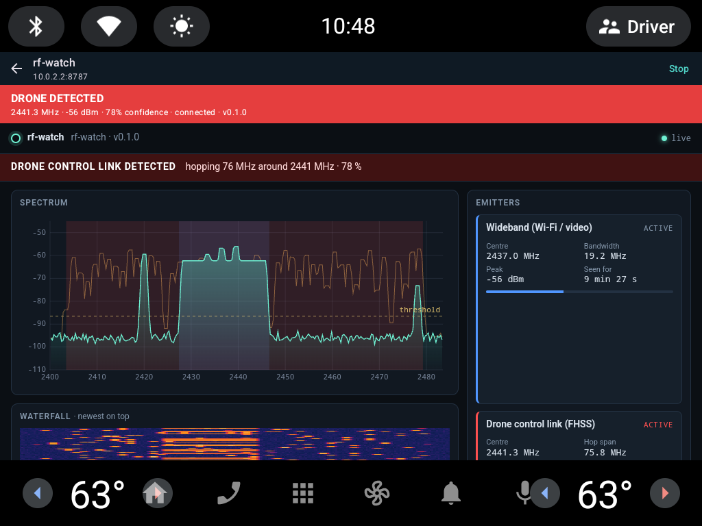
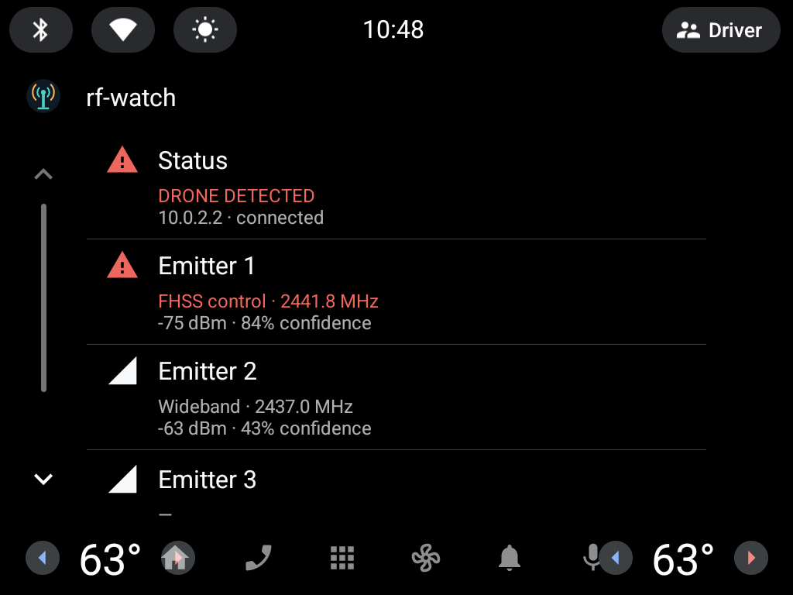

# rf-watch

A small **passive RF drone-link detector** demo: a Rust service that sweeps the 2.4 GHz
ISM band, detects the frequency-hopping remote-control link of a drone among Wi-Fi and
other background traffic, and streams spectrum, waterfall and detections over WebSocket
to an embedded **Svelte** UI. The node advertises itself on the LAN over **mDNS**, so a
mobile client can find it without an IP address.

The RF front end is **simulated** (no SDR needed), or a `hackrf_sweep` / `rtl_power` CSV
capture is **replayed**; the detector only sees power spectra, so it does not know which.

```
           scanner thread (scanner.rs)                          async (server/)
 ┌──────────────────────────────────────────────────────┐
 SweepSource ──Sweep──▶ Detector ──Report──▶ Hub ─broadcast─▶ /ws         JSON frames
 sim | CSV replay       segment → wideband        └─watch──▶ /api/status
 (source/)              → fhss  (detect/)                    /            embedded Svelte UI
 mDNS: _rfwatch._tcp.local.  (mdns.rs)
```

Reading a front end blocks and detection is CPU work, so the pipeline runs on its own
thread; the network side only sees the `Hub` (a broadcast channel of serialized frames and
a watch channel with the latest snapshot).

## Detection

1. **Noise floor** = 25th percentile of the sweep (robust while part of the band is busy);
   threshold = floor + 10 dB.
2. **Segments**: contiguous runs of bins above the threshold.
3. **Wideband** segments (≥ 8 MHz) are tracked by centre frequency with an exponential
   hit rate — Wi-Fi, video downlinks.
4. **Narrowband** bursts (≤ 2.5 MHz) are pooled over a 2 s window. ≥ 2.5 bursts per sweep
   spread over ≥ 15 distinct 1 MHz channels is reported as an **FHSS control link**;
   isolated blips (Bluetooth, clicks) are not. **Hysteresis:** once reported, the link is
   kept while the window meets 60 % of both thresholds, and is declared lost only after 1 s
   below that, so a weak stretch mid-flight does not flap lost/detected. Lost tracks stay
   listed for 10 s.

Every threshold, weight and timeout above is a field of `DetectorConfig` /
`WidebandConfig` / `FhssConfig`, with the values above as defaults.

The `demo` scenario loops every 60 s: background traffic, a drone flies in at 8 s (signal
rises), passes and leaves at 40 s.

## Run

Needs Rust ≥ 1.85 and Node ≥ 20.

```bash
(cd web && npm ci && npm run build)   # UI is embedded into the binary at compile time
cargo run --release
# open http://localhost:8787
```

Options: `--scenario demo|quiet|drone`, `--fps 10`, `--name rf-watch`, `--listen 0.0.0.0:8787`,
`--seed N`, `--no-mdns`, `--input capture.csv`. Logs via `RUST_LOG=debug`.

### Replaying a capture

```bash
hackrf_sweep -f 2400:2484 -w 500000 -N 600 > capture.csv
cargo run --release -- --input capture.csv
```

`--input` reads the CSV layout shared by `hackrf_sweep` and `rtl_power`
(`date, time, hz_low, hz_high, hz_bin_width, num_samples, dB...`) and plays it back at
`--fps`. Lines are grouped into sweeps by frequency (a line starting at or below the first
frequency of the current sweep begins the next one, so `hackrf_sweep`'s interleaved
slices work), each sweep is resampled onto the 2.4 GHz band (strongest capture bin per
band bin; uncovered bins get the sweep's median), and sweep times come from the file.
When the file ends, the node keeps serving the last state.

UI development with hot reload (proxies `/ws` and `/api` to the Rust server on :8787):

```bash
cargo run            # terminal 1
cd web && npm run dev   # terminal 2 → http://localhost:5173
```

The UI connects to `/ws` on the host that served it; `?ws=ws://host:port/ws` overrides
it (e.g. in a WebView that loads bundled assets).

Find the node on the LAN:

```bash
dns-sd -B _rfwatch._tcp        # macOS
avahi-browse -r _rfwatch._tcp  # Linux
```

## Protocol

[`src/protocol.rs`](src/protocol.rs) is the single definition of the wire format. From it,
`cargo test` checks two generated files and fails if either is stale
(`UPDATE_PROTOCOL=1 cargo test` regenerates them):

- [`web/src/lib/protocol.gen.ts`](web/src/lib/protocol.gen.ts): the UI's TypeScript types
  (ts-rs), so a renamed field fails `svelte-check` wherever the UI uses it;
- [`protocol/*.json`](protocol/): sample `hello`, `frame` and status messages, which the
  web and Android tests parse.

Domain types are converted at that boundary, so the detector can change without changing
what clients see.

`GET /ws` — first message `hello`, then one `frame` per sweep:

```json
{"type":"hello","device":"rf-watch","version":"0.1.0",
 "band":{"start_mhz":2400.0,"stop_mhz":2483.5,"bins":256,"fps":10}}

{"type":"frame","seq":812,"t_ms":81200,"noise_floor_dbm":-96.8,"threshold_dbm":-86.8,
 "power_dbm":[-95.9,-97.1,...],
 "tracks":[{"id":3,"kind":"fhss_control","center_mhz":2441.8,"bandwidth_mhz":72.0,
            "peak_dbm":-61.2,"confidence":0.9,"first_seen_ms":10100,
            "last_seen_ms":81200,"active":true}]}
```

`GET /api/status` — snapshot: device, frames processed, connected clients,
`drone_detected`, current tracks.

## Android client

[`android/`](android/README.md) is a native Kotlin + Jetpack Compose client:

- **Discovery** of `_rfwatch._tcp` nodes with Android NSD, plus manual `host:port`
  (`10.0.2.2:8787` from the emulator).
- **Node screen**: the node's own Svelte UI in a WebView, under a native status bar
  (connection state, `DRONE DETECTED` / `clear`) driven by the `/ws` stream
  (OkHttp WebSocket + kotlinx.serialization).
- **Background monitoring**: a `connectedDevice` foreground service keeps the WebSocket
  open with the screen off, reconnects with backoff and posts a notification for every new
  active `fhss_control` track.
- **Android Auto** (Car App Library, IOT category): live status and active emitters on the
  car screen; alerts appear as car notifications.

| Phone / node screen | Car screen (Android Automotive OS emulator) |
|---|---|
|  |  |

```bash
cd android && ./gradlew test assembleDebug   # JDK 21, Android SDK with compileSdk 37
adb install -r app/build/outputs/apk/debug/app-debug.apk
```

## Tests

```bash
cargo test                  # see below
cd web && npm test && npm run check
cd android && ./gradlew test
```

| Where | What |
|---|---|
| `src/detect/` | The detection rules on hand-built sweeps (flat noise + rectangles), independent of the simulator: reporting after n hits, release and drop timing, hysteresis in both directions, few-channel or sparse traffic is not a link, ordering. |
| `src/source/csv.rs` | Grouping interleaved lines, fine and coarse resampling, uncovered bins, midnight, errors with line numbers. |
| `src/scanner.rs`, `src/server/` | End of source, failing source, pacing; HTTP routes. |
| `src/protocol.rs` | Frame building, and that the generated TS types and samples are current. |
| `tests/scenarios.rs` | Simulator → detector end to end: no false alarm, detection latency, no flapping over 40 seeds. |
| `tests/replay.rs` | The simulator recorded as a `hackrf_sweep` CSV replays with identical detections. |
| `tests/websocket.rs` | Server on a real port, `hello` then frames with a detection. |

CI (`.github/workflows/ci.yml`) runs fmt, clippy, tests and both builds, plus the Android
unit tests, lint and debug APK.

## Validation: what is and is not shown

- The detection rules are pinned by unit tests on hand-built input, and the simulator
  scenarios check that the whole chain fits together.
- **Nothing here is validated on real RF.** The simulator was written together with the
  detector, so passing scenarios shows consistency, not field performance. The defaults
  assume about 10 sweeps/s and a hop set like the simulated one (50 channels 1.5 MHz
  apart, about 4 bursts per sweep). Real links (other hop rates, dwell times, bandwidths)
  and real front ends (sweep rate, bin width, AGC, spurs) need recorded captures and
  retuning; `--input` is the way in. The CSV reader is tested on synthetic files in the
  documented format, not yet on a real capture.

## Layout

| Path | Role |
|---|---|
| `src/spectrum.rs` | `Band` geometry and `Sweep`, the input everything downstream works on. |
| `src/source/` | `SweepSource`; `sim.rs` simulated sweeps, `csv.rs` capture replay. |
| `src/detect/` | `segment.rs` noise floor and segmentation, `wideband.rs` tracker, `fhss.rs` hop-set detector; `mod.rs` merges them into a `Report`. |
| `src/scanner.rs` | Pipeline thread and `Hub`. |
| `src/server/` | Routes and `/api/status`, `/ws` client loop, embedded UI. |
| `src/protocol.rs` | Wire types; source of the generated TS types and sample messages. |
| `src/mdns.rs` | `_rfwatch._tcp` advertisement. |
| `protocol/` | Generated sample messages, parsed by the web and Android tests. |
| `web/src/lib/` | Connection with reconnect, spectrum, waterfall, emitter list; `protocol.gen.ts` is generated. |
| `android/` | Android client: NSD discovery, WebView + native alerts, foreground service, Android Auto. |

## Ideas

- Validate and retune on real captures.
- Live input: pipe `hackrf_sweep` into the CSV reader (it takes any reader; a live source
  needs no pacing).
- 5.8 GHz band and video-downlink classification.
