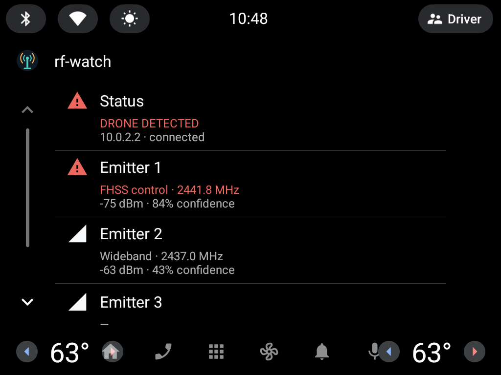
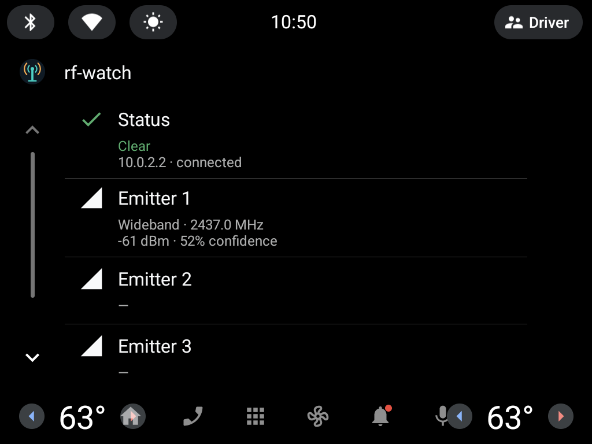

# rf-watch Android client

Native Kotlin + Jetpack Compose client for an rf-watch node: finds nodes on the LAN, shows
the node's own UI, raises drone alerts in the background and on Android Auto.

```
NsdDiscovery ──pick──▶ MonitorService (foreground, connectedDevice)
 (_rfwatch._tcp)          └─ NodeClient: OkHttp WebSocket /ws, reconnect with backoff
                                 │ ClientEvent
                                 ▼
                          NodeRepository.state  (StateFlow<MonitorState>)
                           │            │                 │
              NodeScreen status bar   ongoing +       DetectionsScreen
              + WebView (node UI)     alert notif.    (Android Auto)
```

## Features

- **Discovery**: Android NSD browses `_rfwatch._tcp`; each instance is resolved to
  host:port (`registerServiceInfoCallback` on API 34+, serial `resolveService` below).
  TXT `version` and `ws` (WebSocket path) are used. Manual `host:port` entry as fallback;
  port defaults to 8787.
- **Node screen**: WebView with the node's embedded Svelte UI (`http://host:port/`) under a
  native status bar: connection state and `DRONE DETECTED` / `clear` / `no data`, derived
  from the `/ws` stream, not from the WebView. A disconnected node shows "no data", never
  "clear".
- **Background monitoring**: selecting a node starts `MonitorService`, a foreground service
  of type `connectedDevice` with a persistent notification (status + Stop action). It owns
  the WebSocket (10 s pings, exponential backoff 0.5 s → 15 s, reset after data arrives),
  holds a partial wake lock while monitoring and keeps running when the app is backgrounded
  or the screen is off. Back on the node screen leaves monitoring running; **Stop** (in the
  app or the notification) ends it.
- **Drone alerts**: a high-priority notification for every new active `fhss_control` track
  (once per track id; a reconnect does not repeat it). `POST_NOTIFICATIONS` is requested on
  API 33+ when a node is opened. The alert carries a `CarAppExtender`, so it also appears
  as a heads-up in Android Auto.
- **Android Auto**: `RfWatchCarAppService` (Car App Library, category IOT) shows a
  `ListTemplate`: a **Status** row (`DRONE DETECTED` in red / `Clear` in green / `No data`,
  node and connection) and four **Emitter** rows with kind, centre MHz, peak dBm and
  confidence of the active tracks (drone links first, overflow summarised as "+N more").
  It observes the same `NodeRepository` as the phone UI.
- **Cleartext LAN HTTP**: `res/xml/network_security_config.xml` permits cleartext. Nodes
  are plain-HTTP services on arbitrary LAN IPs / `.local` names, which a domain-specific
  config cannot express.

### Car template refresh limits

The car host allows at most 5 templates per task. An update counts as a *refresh*, which
does not use up that quota, only if the template title, the number of rows and every row
title stay the same. So the car screen uses a fixed layout: constant title `rf-watch`, a
`Status` row and `Emitter 1..4` rows. All live values go into the row texts. Updates are
throttled to at most one per second, and only sent when the content changed.
`CarSummaryTest` checks that the layout has the same shape in every state.

## Build

Needs JDK 21 and the Android SDK with platform `android-37.2` (compileSdk 37, targetSdk 36,
minSdk 26).

```bash
echo "sdk.dir=$ANDROID_HOME" > local.properties
./gradlew test assembleDebug        # unit tests + debug APK
./gradlew lintDebug
adb install -r app/build/outputs/apk/debug/app-debug.apk
```

APK: `app/build/outputs/apk/debug/app-debug.apk`.

## Try it

```bash
# in the repo root
cargo run --release            # node on :8787, advertised as _rfwatch._tcp
```

- **Emulator**: NSD can't see the host's mDNS through the emulator's NAT. Use the manual
  entry `10.0.2.2:8787`.
- **Phone on the same Wi-Fi**: the node appears in the list. Tap it.

The `demo` scenario brings a drone in at 8 s of every 60 s loop, so an alert follows within
seconds. Press Home or turn the screen off and the alert still arrives.

## Car screen on the Android Automotive OS emulator (tested)

The Android Auto phone app can't be installed on a phone emulator (Play reports it as
incompatible), so the car screen is tested on an **Android Automotive OS** emulator. It runs
the same Car App Library templates. Debug builds add `androidx.car.app:app-automotive` and a
launchable `CarAppActivity` (`app/src/debug/AndroidManifest.xml`); release builds are
unchanged.

Setup (once):

```bash
sdkmanager "system-images;android-34-ext9;android-automotive;arm64-v8a"
avdmanager create avd -n AAOS_API_34 -d automotive_1024p_landscape \
  -k "system-images;android-34-ext9;android-automotive;arm64-v8a"
```

Run:

```bash
# terminal 1, repo root: the node with the demo scenario on :8787
cargo run --release

# terminal 2
$ANDROID_HOME/emulator/emulator -avd AAOS_API_34 &
adb wait-for-device
cd android && ./gradlew installDebug
adb shell pm grant com.marosmamrak.rfwatch android.permission.POST_NOTIFICATIONS
adb shell am start -n com.marosmamrak.rfwatch/.MainActivity
```

In the app, type `10.0.2.2:8787` under **Manual connection** and tap **Connect**. This starts
the monitoring service that feeds the car screen. Then open the car screen:

```bash
adb shell am start -n com.marosmamrak.rfwatch/androidx.car.app.activity.CarAppActivity
```

What to check (the demo drone transmits from 8 s to 40 s of every 60 s loop;
`curl -s localhost:8787/api/status` shows `drone_detected` for comparison):

| Check | Expected |
|---|---|
| Car screen opens | Title **rf-watch**, a **Status** row and **Emitter** rows |
| Drone transmitting | Status **DRONE DETECTED** (red), an emitter row *FHSS control · ~2441 MHz* |
| Drone gone (server logs `drone control link lost` and stays clear) | Status switches to **Clear** (green), FHSS row disappears. Measured: 7–9 s on the emulator (see known issues) |
| Live updates over 3+ loops | Screen stays open; the host does not close it for exceeding the template limit |
| Drone alert | `adb shell dumpsys notification` lists *Drone detected · 10.0.2.2* on channel `drone_alerts`; badge on the bell icon |

Last run: 19 Nov 2026, AAOS API 34 emulator, about 12 minutes of demo loops. All checks
passed. Not covered here: the Android Auto phone app itself (see the DHU section below).

Known issues found during this run:

- **Car screen lags the app by several seconds.** After a real departure the app state
  (persistent notification) says *clear* within 1–2 s, but the car screen switches 7–9 s
  later. The screen refreshes at most once per second, so the remaining delay is between
  `invalidate()` and the AAOS host drawing the template. Not yet investigated; check on a
  real head unit before relying on it.
- **Detector flaps while the drone is present.** The node logs `lost` and `detected` again
  0.1–0.5 s apart in the middle of a flight (a few times per loop), because the FHSS rule
  has no hysteresis. Clients see a short *clear*; alerts are not repeated because the
  track id stays the same. Fix belongs in `src/detect.rs` (hold the detection for ~1 s).

| Drone detected | Clear |
|---|---|
|  |  |

## Android Auto with the Desktop Head Unit (DHU)

Needs a real Android phone with Android Auto. Not tested yet: no phone was available.

1. Install the DHU: `sdkmanager "extras;google;auto"`.
2. On the phone, install Android Auto from Play (a phone emulator won't do: Play marks
   Android Auto as incompatible there), open its settings,
   tap **Version** ten times to unlock developer mode, then in the overflow menu choose
   **Developer settings** → enable **Unknown sources** (needed for apps not installed
   from Play) and **Start head unit server**.
3. Forward the port and start the DHU:
   ```bash
   adb forward tcp:5277 tcp:5277
   $ANDROID_HOME/extras/google/auto/desktop-head-unit
   ```
4. Start monitoring a node in the phone app, then open **rf-watch** from the DHU launcher.
   Debug builds accept any car host (`HostValidator.ALLOW_ALL_HOSTS_VALIDATOR`). Release
   builds only accept the Google hosts listed in `res/values/car_hosts.xml`.

Tip: Android Auto developer settings → **Enable debug overlay** shows the template step
counter. It should stay put while detections update.

## Tests

JVM unit tests (`app/src/test`):

| Test | Covers |
|---|---|
| `ProtocolTest` | `hello` / `frame` parsing as sent by the Rust server, unknown fields and kinds, malformed messages, `drone_detected` rule. |
| `MonitorStateTest` | Connection state machine, stale data cleared on disconnect, track ordering, one alert per new drone track, backoff. |
| `NodeAddressTest` | Manual `host:port` parsing (default port, scheme, IPv6). |
| `CarSummaryTest` | Car layout stays refresh-compatible; status and emitter rows. |
| `NodeClientTest` | WebSocket client end to end against MockWebServer, including reconnect. |

## Layout

| Path | Role |
|---|---|
| `model/Protocol.kt` | `/ws` messages (kotlinx.serialization), `droneDetected`. |
| `model/NodeAddress.kt` | Node address, URLs, manual input parsing. |
| `discovery/NsdDiscovery.kt` | NSD browse + resolve of `_rfwatch._tcp`. |
| `monitor/NodeClient.kt` | OkHttp WebSocket with reconnect (pure JVM). |
| `monitor/MonitorState.kt` | State, reducer, alert tracker, backoff. |
| `monitor/NodeRepository.kt` | Shared `StateFlow` for UI, notification and car. |
| `monitor/MonitorService.kt` | Foreground service. |
| `monitor/Notifications.kt` | Channels, ongoing and alert notifications. |
| `ui/` | Compose screens: discovery, node (status bar + WebView). |
| `car/` | Car App Library service, session, screen, `CarSummary`. |
